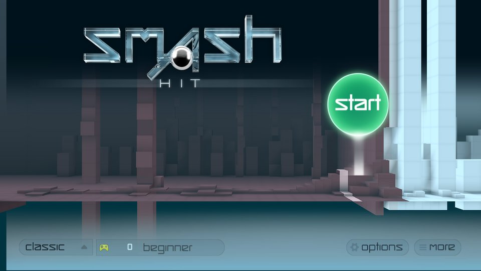
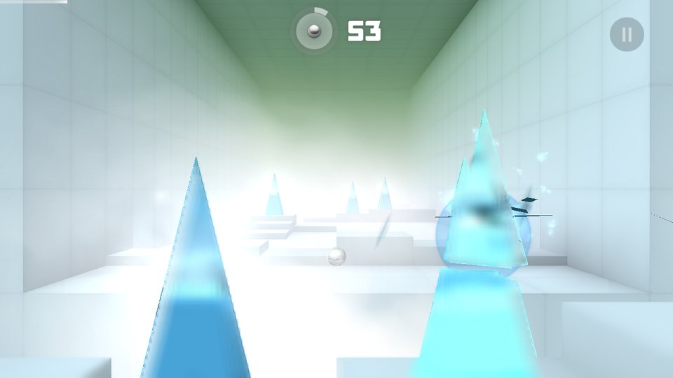
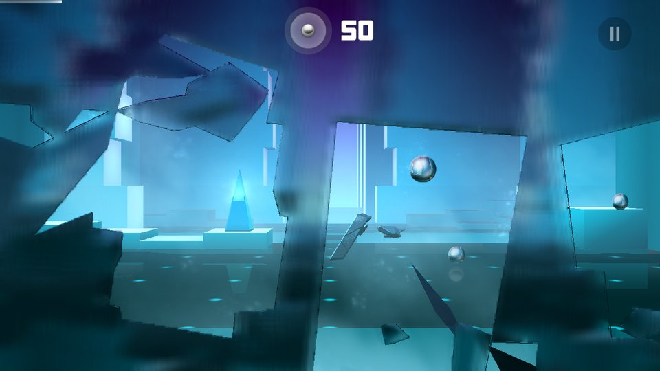
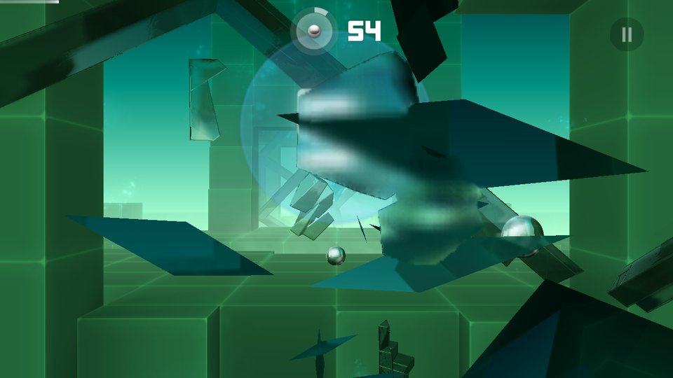
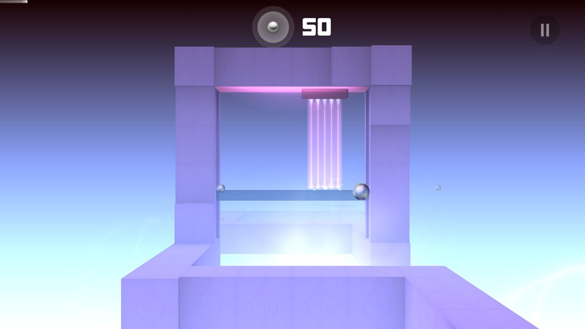
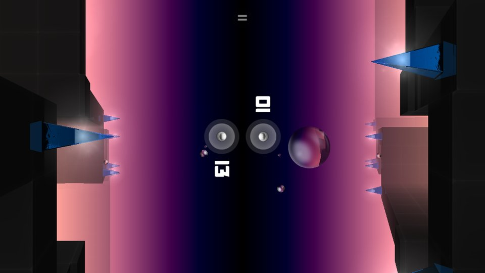

# OpenSmash

An open-source engine for Smash Hit, the 2014 mobile game by Mediocre AB. It plays the original game data on
Windows, Linux and macOS.

| | |
|---|---|
|  |  |
|  |  |
|  |  |

Almost all of Smash Hit lives outside its executable. Rooms, obstacles, bosses, the menu and the HUD are Lua scripts;
levels and room layouts are XML files and pre-lit meshes. OpenSmash is a new engine written in C++17 that loads those
files and provides what they expect from the original: rigid-body physics with breakable glass, the renderer and its
shaders, the camera that moves in time with the music, the audio mixer, and the ~170 `mg*` functions the scripts call.
The game's own scripts run unmodified.

OpenSmash is an unofficial fan project. It is not affiliated with or endorsed by Mediocre AB.

## Status

The whole game is playable: the 12 campaign levels and endless mode, checkpoints, training, classic, expert and zen
modes, two-player versus and co-op, powerups, boss rooms and the first-run tutorials. There are no ads, purchases or
network access, and the premium modes are unlocked.

Development happened on Linux x64. CI builds and tests the Windows, macOS and Linux ARM64 versions, but nobody has
played them on real hardware yet, so reports from those platforms are very welcome.

Known differences from the phone version are listed in [docs/DIFFERENCES.md](docs/DIFFERENCES.md).

## Playing

Download a package from [Releases](../../releases/latest) and extract it. Release packages include the game data.

- **Windows 10 (1903+) / 11 (x64):** run `OpenSmash.exe`. The exe isn't code-signed, so SmartScreen may ask for
  confirmation (More info, then Run anyway).
- **macOS 12+ (Apple Silicon):** open `OpenSmash.app`. It isn't notarized, so the first launch is blocked: on macOS 15+
  allow it under System Settings > Privacy & Security > Open Anyway; on 12-14 right-click it and choose Open.
- **Linux x64/ARM64** (glibc 2.39+, e.g. Ubuntu 24.04, Debian 13, Fedora 40): run `./opensmash`.

A build without game data (your own build or a CI artifact) asks for a Smash Hit `.apk` on first launch. You can also
put the APK next to the executable, or pass `--assets` with the APK or a folder it was unzipped into.

Controls: click or tap to throw, Esc to pause, F11 or Alt+Enter for fullscreen. With a gamepad the sticks aim, A or the
right trigger throws, B goes back and Start pauses; a second gamepad is player 2 in versus and co-op. On a touchscreen
every finger throws, so two players can share one screen.

Saves are kept in `%APPDATA%\OpenSmash` (Windows), `~/Library/Application Support/OpenSmash` (macOS) or
`~/.local/share/OpenSmash` (Linux). `--user-dir DIR` keeps them somewhere else, e.g. for a portable install.

## Building

You need CMake 3.25 or newer, a C++17 compiler and Ninja. SDL3, Lua 5.2, miniz and stb are included in `third_party/`,
so the build doesn't download anything.

```sh
cmake --preset linux-gcc        # or linux-clang, windows-msvc, windows-clangcl, macos-arm64
cmake --build --preset linux-gcc
build/linux-gcc/opensmash --assets /path/to/smashhit.apk
```

The windows-msvc preset uses Visual Studio 2022 instead of Ninja: its binaries end up in
`build/windows-msvc/RelWithDebInfo/`, and ctest needs `-C RelWithDebInfo`.

On Linux an installed SDL3 is used when available; `-DSH_SYSTEM_SDL3=OFF` builds the bundled copy, which needs the
usual X11/Wayland, ALSA/PulseAudio and GL development packages (see `.github/workflows/build.yml` for the list).
`opensmash --help` lists the command-line options.

The Windows x64 build can also be cross-compiled with zig (`pip install ziglang`): `tools/make-zig-wrappers.sh DIR
[PYTHON]` writes wrappers for zig's cc, c++, ar and ranlib into `DIR` (`PYTHON` is the interpreter that has ziglang,
`python3` by default); then set `ZIG_WRAPPERS` to the absolute path of `DIR` and configure with
`-DCMAKE_TOOLCHAIN_FILE=cmake/zig-windows-x64.cmake`. `cmake/zig-linux-arm64.cmake` works the same way for the
headless runner and tests (`-DSH_BUILD_GAME=OFF`); the ARM64 game itself needs an ARM64 sysroot with SDL's
development packages, so it is built natively.

### Tests

```sh
ctest --test-dir build/linux-gcc                                   # unit tests, no game data needed
SH_ASSETS=/path/to/smashhit.apk ctest --test-dir build/linux-gcc   # also loads every asset and script
```

`opensmash_headless --assets smashhit.apk --level all --full` has a bot play through every campaign room, and
`opensmash --offscreen --level 0 --ticks 600 --screenshot out.png` renders a frame without opening a window.

## Documentation

- [How it works](docs/HOW_IT_WORKS.md): a tour of the engine and the source tree
- [Differences from the original](docs/DIFFERENCES.md)
- [Asset formats](docs/formats/README.md)
- [Releasing](docs/RELEASING.md)

## Contributing

Bug reports, platform reports and pull requests are welcome; see [CONTRIBUTING.md](CONTRIBUTING.md). Please don't
attach APKs or game files to issues.

## License

OpenSmash is released under the [MIT License](LICENSE). The bundled libraries are listed in
[THIRD_PARTY_NOTICES.md](THIRD_PARTY_NOTICES.md).

Smash Hit and all of its content are © Mediocre AB, and "Smash Hit" is their trademark. This repository contains no
game data. The data in release packages is distributed with Mediocre AB's permission and is not covered by the MIT
License (see `ASSETS_NOTICE.txt` in each package). OpenSmash contains none of the original program code and does not
load or emulate the original binary.

Screenshots were rendered by OpenSmash; the artwork in them is © Mediocre AB.
